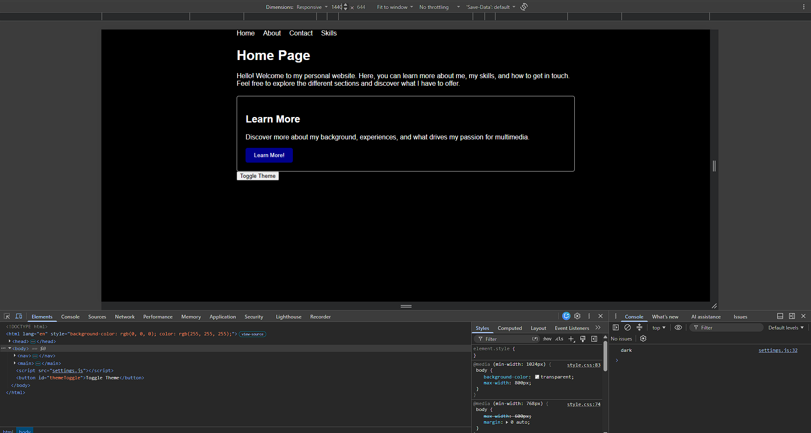
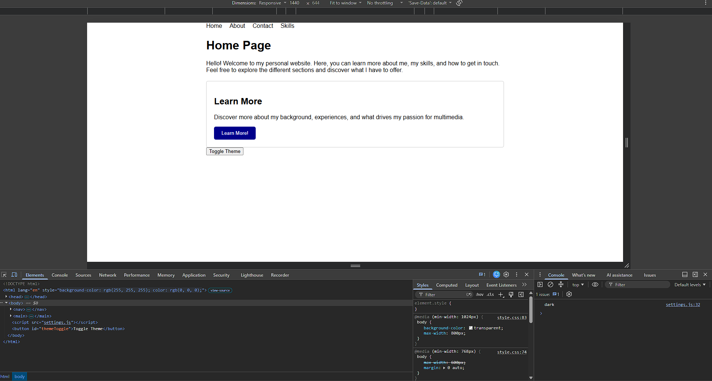

# it0043-portfolio

## Overview
Includes personal details and information about user. It is used for showcasing user's skills in the field of Multimedia Arts. 

## Features
- Multipage Navigation Menu
- Responsive Layout
- Theme Toggle

## Technologies
- HTML
- CSS
- JavaScript
- Visual Studio Code
- InfinityFree
- Github

## Setup
1. Download project through uploaded git files
2. Open index.html in web browser

## Live Demo URL
- http://kylepullan.free.je

## Screenshots

## Credits
- Kyle Pullan

## AI Use
- M7-TECHNICAL: Used for prompting the AI checklist

## What I Verified & Built Myself
- HTML, CSS, JavaScript, & README.md files
